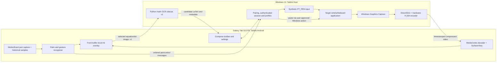

# TabInk: System Design Document

**Version:** 1.0 | **Date:** 18 November 2026  
**Targets:** Samsung Galaxy Tab S10 FE, included S Pen, Windows 11  
**Purpose:** A local, USB-first remote Windows pen display for precise mathematical handwriting, with handwriting-to-LaTeX for Overleaf in v1.  
**Status:** Proposed architecture. Measured performance and individual app compatibility remain to be validated.

## Executive decision

**Build a driver-free feasibility prototype before building a full streaming product.** Use a native Kotlin Android tablet client, a C++ Windows capture/pen core, and a C# Windows settings/tray interface. Start with Android `MotionEvent` historical stylus samples, a separate low-latency pen/control channel through `adb reverse`, native Windows `CreateSyntheticPointerDevice(PT_PEN)` and `InjectSyntheticPointerInput`, Windows Graphics Capture for an explicitly selected application window, H.264 low-delay hardware encoding, Android `MediaCodec` decoding, and a local, front-buffer ink overlay. Later add TLS-protected Wi-Fi and an optional Python OCR sidecar using TexTeller/Pix2Text. Do not write a virtual HID driver for MVP.

**Reality check:** Use Samsung Notes, Goodnotes, or OneNote natively if immediate note-taking is the only goal. Samsung Second Screen, spacedesk and SuperDisplay already solve many pen-display tasks. TabInk is defensible as a free/open-source project only if it delivers (a) selected-window precision, (b) trustworthy native Windows Ink, (c) low-latency math-oriented actions, and (d) local handwriting-to-LaTeX-to-Overleaf in one workflow. The Samsung Tab S10 FE has a **90 Hz, 2304 × 1440** screen and **USB 2.0**, not a 120 Hz/USB 3 device. Its S Pen is pressure-sensitive but does not provide BLE Air Actions. Goodnotes Windows and Android are supported, but full cross-platform library synchronization depends on a Goodnotes Cloud-capable plan/account. Samsung Notes on Windows is officially Samsung-PC-oriented. Microsoft retired standalone Whiteboard apps on 16 October 2026; target supported web/Teams Whiteboard instead.

**References:** [Samsung S10 FE](https://www.samsung.com/us/support/answer/ANS10005059/), [Samsung hardware specifications](https://www.samsung.com/uk/business/tablets/galaxy-tab-s/galaxy-tab-s10-fe-grey-256gb-wi-fi-sm-x520nzapeub/), [Goodnotes Cloud](https://support.goodnotes.com/hc/en-us/articles/10277366719759-Sync-your-Goodnotes-library-across-all-platforms-with-Goodnotes-Cloud), [Samsung Notes PC support](https://www.samsung.com/us/support/answer/ANS10001469/), [Whiteboard retirement](https://support.microsoft.com/en-us/whiteboard/retirement-standalone-microsoft-whiteboard-apps).

## 0. Alternatives reviewed first

| Option | Works well for | Why not enough by itself |
|---|---|---|
| Samsung Notes on tablet | Best immediate handwritten S Pen notes, PDF reading, math classes | Windows application not officially available on arbitrary PCs; does not inject pen into arbitrary Windows apps |
| Goodnotes Android + Windows | Notebook workflow with account-based synchronization | Sync plan/account limitations; app capabilities differ; no unified Overleaf action |
| OneNote on Android + Windows | Cross-platform note taking/sync | Native notes live in OneNote rather than arbitrary Windows whiteboards or PDF apps |
| Samsung Second Screen | Built-in wireless Windows display extension and S Pen interaction | Primarily display mirroring/extension, not selected-window capture and Math OCR automation; test pen pressure experimentally |
| spacedesk | Android display extension including stylus and USB options | Third-party closed integration; S Pen button/pressure support may vary by release and app |
| SuperDisplay | Mature USB/wireless pen display with Windows Ink, optional WinTab | Proprietary/paid; Math OCR and open-source customization absent |
| Weylus | Open-source streaming with stylus concepts | Primary high-fidelity virtual stylus uses Linux `uinput`; Windows is not equivalent out of the box |
| Deskreen | Browser screen/window viewing | Screen viewing, not a reliable native Windows pen digitizer |
| pix2tex, Pix2Text, TexTeller | Formula image to LaTeX | Not an integrated remote pen display or edit/paste workflow |

Try Samsung Second Screen, spacedesk, and SuperDisplay's trial on *this exact tablet and PC* for pen pressure, hover, hover button, palm rejection, and small subscripts. Skip TabInk if an existing workflow satisfies the real use case.

## 1. High-level architecture



The **Windows desktop user-session process** owns capture, pen injection, app targeting, and policy. It is not a Windows service in Session 0. Android owns S Pen acquisition, touch filtering, immediate local feedback and the display. The system uses separate channels for pen, control and video so a slow video frame cannot block a pen release. Saving notes remains the responsibility of the target Windows application; TabInk does not pretend it has saved a remote document.

## 2. Android client

**Views/input.** Develop in Kotlin. A custom `View` receives `onTouchEvent` and `onHoverEvent` with `MotionEvent` rather than relying solely on Compose high-level pointer abstractions. Inspect every pointer's `getToolType(index)` for `TOOL_TYPE_STYLUS` or `TOOL_TYPE_ERASER`; read `getActionMasked()`, `getActionIndex()`, `getPointerId()`, x/y, `getPressure(index)`, `AXIS_DISTANCE` where available and `getButtonState()` with `BUTTON_STYLUS_PRIMARY`/`SECONDARY`. Iterate `getHistorySize()` *before* current data; for each historical index read `getHistoricalX/Y/Pressure` and timestamp (`getHistoricalEventTimeNanos` where supported), then read current sample. Do not discard historical points just because the UI updates at 90 Hz. `ACTION_HOVER_ENTER/MOVE/EXIT` are separate from contact. Inspect empirical pressure distribution; Android's scale and hover distance are device-dependent. A side button is not a Bluetooth Air Action; capture only events the OS actually delivers.

**Palm strategy.** Send pen only on stylus/eraser tool types; discard accidental palm contacts during pen contact and for a configurable 100-200 ms after pen leaves contact. When stylus hovers in range, default to rejecting fingers near the pen; optionally reject all finger input during hover in strict mode. Permit two-finger pan only after the pen is out of range, or when a dedicated Hand mode is active. This is an app-level heuristic, not OS-grade palm rejection for other apps. If the system consumes button events for Air Command, expose a toolbar eraser fallback and test Samsung settings.

**Graphics.** Decode H.264 with hardware `MediaCodec` into a `SurfaceView`, attempt `KEY_LOW_LATENCY` where supported. Place a separate transparent local stroke rendering layer over the video, preferably using Jetpack Graphics `GLFrontBufferedRenderer` or its current supported successor; gate on actual device support and use regular OpenGL `SurfaceView` fallback. Keep mapped coordinates in a single canonical space. Compose draws the toolbar/settings outside the ink surface, avoiding UI recomposition per sample. Ink overlay is transient, never stored as note content.

**Threads.** UI thread processes callbacks briefly; enqueue immutable pen samples in a lock-free or bounded SPSC ring, a high-priority sender serializes and sends; independent decoder, renderer, settings and reconnect coroutines operate separately. Do not allocate an object for every point on the hot path if performance demands pooled structs. Use an appropriate user-initiated `connectedDevice` foreground service with notifications only when needed and when its current Android permission prerequisites are satisfied. Keep the tablet awake while visible and streaming using `FLAG_KEEP_SCREEN_ON`; do not hold unrestricted CPU wake locks. Stop injection on backgrounding. Do not bypass Android foreground-service restrictions.

References: [MotionEvent](https://developer.android.com/reference/android/view/MotionEvent), [advanced stylus support](https://developer.android.com/develop/ui/views/touch-and-input/stylus-input/advanced-stylus-features), [Android front-buffer tutorial](https://developer.android.com/codelabs/large-screens/advanced-stylus-support), [foreground service types](https://developer.android.com/develop/background-work/services/fgs/service-types).

## 3. Windows window/video capture

**Prefer Windows Graphics Capture (WGC)** with OS permission UI and explicit user-selected window. WGC captures a selected window via `GraphicsCaptureItem` and D3D11 frame pool; it is significantly simpler for a single application window than Desktop Duplication. Desktop Duplication is a monitor-capture fallback and provides dirty/move region information, but not native isolated single-window capture. A custom region is a crop of consented monitor capture, not a way to capture a protected window without permission.

GPU path: `GraphicsCaptureItem -> Direct3D11CaptureFramePool -> BGRA texture -> crop/scale and YUV conversion -> Media Foundation H.264 low-delay hardware encoder -> framed video packets`. Recreate capture pools/encoder on size changes; define how window shadows, title bars and borders are cropped. Disable captured Windows cursor when the local hover cursor is shown. WGC should capture obscured ordinary windows in many cases, but never assume capture works when minimized, protected, secure-desktop, or on every GPU; mark capture unavailable and pause pen injection instead of sending stale ink.

**Default stream:** H.264 at approximately 1600-2304 px horizontal resolution, up to 60 fps (tablet is 90 Hz; 90 fps decoding/capture is not assumed), low-delay/no B-frames, 1-2 encode reference frames where accepted, short intra refresh/periodic IDR, 6-12 Mbit/s provisional USB bitrate, adaptive to content and codec support. These are starting points, not measured throughput claims. Maintain thin-line readability: use native or integer-near scaling where possible, no aggressive blur, conservative H.264 quantization, avoid text-chroma bleeding, and test white background/black 1 px strokes. Main-stream H.264 4:2:0 is the best decoder compatibility default; HEVC/AV1 only after testing. Encode only changed frames or emit periodic refresh/heartbeats; avoid unconditional 60 fps when a page is static. Adjust rate to 15-30 fps while idle, 60 fps during writing or scrolling, and downshift when battery/heat thresholds are reached. Frame messages include `frame_id`, capture timestamp, map epoch, crop rect and content dimensions.

References: [Windows screen capture](https://learn.microsoft.com/en-us/windows/apps/develop/media-authoring-processing/screen-capture), [GraphicsCaptureSession](https://learn.microsoft.com/en-us/uwp/api/windows.graphics.capture.graphicscapturesession), [Desktop Duplication](https://learn.microsoft.com/en-us/windows/win32/direct3ddxgi/desktop-dup-api), [MF low latency](https://learn.microsoft.com/en-us/windows/win32/medfound/mf-low-latency).

## 4. Transport, protocol, pairing

| Transport | Pen | Video | Recommendation |
|---|---|---|---|
| ADB reverse over USB | Reliable TCP, separate small stream | Separate TCP stream | **MVP**; developer mode/USB debugging needed |
| Android USB tethering | IP sockets, routing varies | IP sockets | User-facing USB option if supported/tested |
| Android Open Accessory (AOA/AOAP) | Custom framing over accessory | Same | Consider v2; more Windows USB integration effort |
| Wi-Fi TCP + TLS | Reliable, simple; HOL possible | Separate stream can stall under loss | First optional Wi-Fi implementation |
| WebSockets over TLS | Easy debugging/browser interoperability | Video framing overhead/TCP HOL | Control/debug, not ideal final video |
| UDP custom | Fast but no security, sequencing or congestion by default | Requires FEC/retransmission/jitter controls | Avoid inventing a whole secure media protocol |
| WebRTC / QUIC | Encrypted low-latency media/data channels | Congestion-controlled media or datagrams | v2 once USB is stable |

**MVP USB commands:** Windows starts a loopback listener on TCP 27180 (control/pen) and 27181 (video). Run `adb reverse tcp:27180 tcp:27180` and `adb reverse tcp:27181 tcp:27181`. Android connects to its own `127.0.0.1` ports, which ADB tunnels to PC. Use application-layer authenticated TLS on both streams, even on USB, so the security model remains consistent with Wi-Fi. Separate fixed-priority queues for transitions and hover/move; no video writes on the pen thread. Use TCP_NODELAY for pen. Avoid Nagle/delayed acknowledgment stalls. Cap all queues and shed old video frames rather than pen-down/up events.

**32-byte little-endian pen packet (protocol v1):**

| Offset | Type | Name | Meaning |
|---:|---|---|---|
| 0 | u16 | magic | `0x5449` ("TI") |
| 2 | u8 | version | `1` |
| 3 | u8 | kind | `1=sample`, `2=control`, `3=ack` (other messages separately framed) |
| 4 | u32 | session_id | Random per session |
| 8 | u32 | seq | Monotonic per direction |
| 12 | u64 | timestamp_us | Android monotonic time in microseconds |
| 20 | u16 | x_norm | 0..65535 in active tablet content rect |
| 22 | u16 | y_norm | 0..65535 in active tablet content rect |
| 24 | u16 | pressure | normalized 0..1024, zero for hover |
| 26 | u16 | flags | bit0 contact, bit1 in-range, bit2 release, bit3 eraser, bit4 predicted (never inject), bit5 canceled |
| 28 | u16 | buttons | bit0 primary, bit1 secondary |
| 30 | u16 | map_epoch | current mapping version |

Press/down, every raw or historical move sample in order, and explicit up/cancel are critical. A 32-byte sample at 240 samples/second needs ~7.5 KiB/s before transport overhead; USB 2.0 is not the main input bandwidth constraint. Sequence gaps are logged. Video uses its own length-delimited framing and monotonically increasing frame identifiers; never confuse video frame rate with pen sampling.

**Handshake:** PC opens capture window and pairing QR containing a one-use random token and pinned host public-key fingerprint. Tablet scans QR, starts TLS 1.3 with fingerprint validation, returns its generated public key and user-confirmed pairing proof; PC confirms and stores the pair. For Wi-Fi, mDNS publishes only service name/port, not credentials. Require explicit PC approval for new devices, short-lived session tokens, mutual authentication for subsequent connections, key rotation/revoke, and encryption for all channels. Add clock offset estimation from several low-RTT ping/pong rounds, sequence counters, negotiated protocol/features/codec, video viewport metadata, and reconnect resume with a new session ID. On reconnect, synthesize pen-up first and request new keyframe/mapping state. Do not trust old pointer-down state.

## 5. Native Windows pen input

**Recommended:** `CreateSyntheticPointerDevice(PT_PEN, 1, POINTER_FEEDBACK_DEFAULT)` and `InjectSyntheticPointerInput` in a Windows desktop user-session process. Populate `POINTER_TYPE_INFO` containing `POINTER_PEN_INFO`, `POINTER_INFO.pointerFlags` and `ptPixelLocation`, `penMask=PEN_MASK_PRESSURE`, `pressure 0..1024`, `penFlags` (including eraser when supported), and proper in-range/in-contact/down/update/up transitions. `InjectSyntheticPointerInput` expects count=1 for a pen; call it in chronological sample order. Use a fixed pointer identity for the life of a stroke; end/cancel on disconnect. Validate concrete event sequences with Microsoft's pointer event APIs and a diagnostic target app. The Windows Ink-capable target should see pen input, not only a simulated mouse. Test eraser and side-button behavior in each app; not every app interprets synthetic pen buttons identically.

| Technique | Good for | Major tradeoff |
|---|---|---|
| User-mode PT_PEN synthetic pointer | Windows Pointer/Ink apps; pressure and pen flags; zero custom driver signing | Not guaranteed to match hardware for all apps; no WinTab by default |
| Virtual HID digitizer using VHF | Broader genuine device identity, legacy compatibility possibility | VHF requires a kernel-mode KMDF/WDM source driver (UMDF does not make VHF user-mode); driver signing/deployment burden |
| OpenTabletDriver/VMulti-style stack | Study existing driver abstractions | External driver/plugin dependency; not a direct no-driver solution |

**Compatibility policy:** OneNote Windows, Xournal++, Edge PDF ink and Windows Ink drawing surfaces are first-tier tests; browser whiteboards (`PointerEvent.pointerType='pen'`) are also tested but pressure/palm treatment varies by browser and library. Goodnotes Windows is tested as installed. Samsung Notes Windows is tested only on officially supported machines. The retired standalone Microsoft Whiteboard is *not* a target; Whiteboard web/Teams is conditional on account/browser. **WinTab-only programs are unsupported in MVP/v1**; a driver or verified shim is a separate v2 decision. Do not claim that synthetic injection is equivalent to a physical HID tablet. Avoid injecting into elevated apps, UAC prompts or secure desktop; `SendInput` keyboard shortcuts are subject to UIPI and foreground focus, and synthetic pen may have similar practical restrictions.

References: [CreateSyntheticPointerDevice](https://learn.microsoft.com/en-us/windows/win32/api/winuser/nf-winuser-createsyntheticpointerdevice), [InjectSyntheticPointerInput](https://learn.microsoft.com/en-us/windows/win32/api/winuser/nf-winuser-injectsyntheticpointerinput), [POINTER_PEN_INFO](https://learn.microsoft.com/en-us/windows/win32/api/winuser/ns-winuser-pointer_pen_info), [VHF driver](https://learn.microsoft.com/en-us/windows-hardware/drivers/hid/virtual-hid-framework--vhf-), [OpenTabletDriver](https://github.com/OpenTabletDriver/OpenTabletDriver).

## 6. Coordinate mapping and synchronization

Let `(u,v)` be normalized tablet ink-view coordinates in [0,1]^2 after excluding toolbars and black letterbox margins. Let `R=(L,T,W,H)` be the *actual captured content rectangle in virtual desktop physical pixels*, not logical DIPs. For an uncropped fit, map `x_pc=L+uW`, `y_pc=T+vH`; for tablet rotation use a 3x3 affine transform before applying `R`. A 180-degree left-handed rotation is `u'=1-u`, `v'=1-v`; 90/270 use the corresponding axis swap. If a custom zoom/pan or crop is active, map through the inverse source-to-view transform. Unletterbox **before** normalization. Recompute whenever the window moves/resizes, monitor changes, DPI changes, display rotation changes, or capture frame dimensions change. Use Win32 per-monitor DPI awareness v2 and `GetDpiForWindow` / physical window bounds, and keep the virtual desktop origin (which can be negative with monitors to the left). Avoid mixing `GetClientRect` logical units with a screenshot including title bar and borders. Read actual WGC crop/surface metadata rather than assuming the whole HWND frame maps to client content.

Maintain an immutable `MappingSnapshot{epoch,source_rect,view_rect,scale,rotation,monitor_id,capture_size}`. The Android client sends the `map_epoch` with each pen sample; Windows rejects or rebases stale epochs only when it can prove transforms are compatible. On window change mid-stroke, cancel pen gracefully rather than teleport ink. Detect alignment using a calibration crosshair and tap-grid photographs: aim for **median error <=1 displayed tablet pixel**, p95 <=2 pixels within stationary layouts. Calibrate and persist per target window profile. Physical fractional pixel positions are not guaranteed across codec scaling or font rendering.

## 7. Local ink preview and reconciliation

Create each provisional stroke from an immutable `stroke_id`, sample sequence, timestamp and mapping epoch; render raw-to-filtered geometry *at the tablet* immediately. Overlay opacity should be high enough to show the path but not visually twice as dark after a remote stroke arrives. Never interpret `InjectSyntheticPointerInput` return value as proof that the target app painted ink. Maintain three states: `provisional` (local only), `awaiting_remote` (Windows accepted samples but may not yet have rendered), `confirmed` (remote pixels observed near expected path in a captured frame or through an explicitly instrumented target). Prefer a modest ink-region image difference/edge confirmation over merely a timestamp or host ACK; for an arbitrary app this is necessarily heuristic and can fail in patterned backgrounds. As a fallback, fade local stroke after the first sufficiently new frame plus a short 1-2 frame grace window, with diagnostics and a user toggle for preview off.

For speed, do **not** do heavy pixel comparisons on the input thread. Composite local ink and remote video with one rendering timeline; remove/fade on video frame boundaries, not asynchronously mid-frame. Mask the provisional stroke for at most a few frames after strong confirmation and never retain it indefinitely. If an app draws with a different brush/color, do not attempt to reconstruct its exact stroke: show thin neutral ghost preview then fade quickly. Disable local preview for selection/lasso/eraser if its semantics cannot be predicted. For the MVP, implement preview as optional until true ghost-free behavior is measured.

## 8. Mathematical handwriting quality

All source samples, including Android historical samples, are retained with monotonic timestamps and `stroke_id`. Transmit raw data unchanged in coordinates; apply any pressure curve only in a versioned transform so diagnostics can compare raw and injected. Do not smooth aggressively or strip short strokes: `i`, `j`, dots, primes, a minus sign, 1-2 mm subscripts and matrix brackets must survive. No synthetic 'hook' when pen first touches; render the first point at its actual position, do not extrapolate from stale hover, and do not extend Bézier handles past the final point. A tiny adaptive moving-average/One-Euro filter may improve visible preview only after demonstrating it does not shift endpoints. Preserve true contact-up and distinguish short tap/dot from missing point. Limit interpolation to visual strokes, never invent transport events to make up for packet loss.

**Zoom-to-write workflow:** User taps Zoom, selects a 4:1 or 2:1 region on the Windows canvas, sees that crop enlarged on tablet, writes a small subscript or dense line, and taps Exit Zoom. The host still receives correct coordinates in source content; it is not a Windows Ctrl+zoom unless configured. Provide a small navigator and a two-finger pan mode when pen is out of range. This is safer for dense equations than aggressive smoothing or reducing pen width to hairline size.

## 9. Latency budget and feasibility

The device panel refreshes at 90 Hz, i.e. roughly 11.1 ms per screen refresh. **Under 30 ms full Windows round trip is a stretch goal, not an honest MVP guarantee.** It includes a Windows application's variable repaint and two display/graphics pipelines. Make local feedback fast, and target consistent p95 rather than a single lucky frame.

| Stage | Engineering target (ms) | Optimizations |
|---|---:|---|
| Pen hardware sampling to app delivery | 3-8 | Consume historical samples immediately |
| Android serialization and USB forwarding | 1-3 | Small fixed packet; separate nonblocking control socket |
| Windows pen injection dispatch | 1-3 | User-mode native pen, high-priority ordered queue |
| Windows app draws stroke | 5-12 | Avoid slow apps; monitor present timing |
| WGC capture availability | 2-7 | D3D11 frame pool, avoid frame queue buildup |
| GPU encode | 3-7 | Hardware H.264, zero B-frames, low-delay configuration |
| USB video transmission | 1-3 | Small video buffers, separate channel |
| Hardware video decode | 3-7 | MediaCodec low-latency flag if supported |
| Tablet composition and scanout | 5-12 | SurfaceView and newest-frame display |
| **Illustrative sum** | **24-61** | Actual p50/p95 may be worse; measure |

System goals: **local preview p50 <15 ms, p95 <25 ms**, **remote visible ink USB p50 <45 ms, p95 <75 ms** as provisional targets, and no visible wrong-location strokes. Add a stretch target of <30 ms pen-to-remote-ink only for tested apps/hardware when demonstrated. Measure separately during scrolling and with USB versus Wi-Fi; track variance, not just the mean.

## 10. Toolbar, gestures and profiles

User-customizable toolbar: pen, eraser, highlighter, lasso, four colors, undo, redo, new page, zoom 2x/4x, pan mode, LaTeX convert, copy, and paste. Buttons transmit abstract actions, e.g. `TOOL_SELECT(ERASER)` rather than hard-coding `e` on Android. On Windows, a trusted per-app profile maps actions to verified keyboard shortcuts, accessible UI automation, or a synthetic eraser flag. Mapping should *never* assume that selecting an eraser inside a Windows app is identical to sending a pen eraser flag. Undo/redo are usually Ctrl+Z/Ctrl+Y or Ctrl+Shift+Z, but should be editable and tested.

| Profile | Defaults | Caveat |
|---|---|---|
| OneNote desktop | Pen, eraser, lasso, color palette, undo, new page | UI/shortcuts vary between OneNote versions |
| Goodnotes Windows | Pen, eraser, highlighter, color | Discover and store actual supported shortcuts; don't fabricate them |
| Samsung Notes Windows | Same only if installed on an officially supported PC | Otherwise disable profile |
| Whiteboard web/Teams | Pen/eraser, pan, select, browser zoom if necessary | Not retired standalone app; exact shortcut support varies |
| Excalidraw / tldraw | Pen, hand/pan, eraser, select, undo | In-browser shortcuts and tool state depend on version |
| Xournal++ / Edge / Acrobat | Pen/highlight/annotate/zoom | Each app requires separate hotkey/ink tests |
| Overleaf | Convert selection, copy LaTeX, paste LaTeX, inline/display toggle | Only paste into the focused source editor; no pen drawing assumed |

Auto-switch by Windows foreground HWND and executable signature, with manual override. Browser tabs require an optional *consented extension* or user-selected per-tab profile (URL cannot be reliably inferred from an arbitrary browser window via Win32 alone). Avoid scraping private browser content unnecessarily. Gestures: two-finger scroll/pan while pen is out of range, pinch-zoom either remote canvas with per-app shortcut or local view zoom with clear UI distinction; long-press pen button for eraser only if device delivers button state. When a toolbar button is tapped, don't forward that event as ink.

## 11. Configuration and UX

Windows host is authoritative for paired devices, allowed apps, screen/window selection, and security; Android keeps latency-critical view preferences. Exchange versioned JSON/CBOR settings changes with `settings_revision` and explicit acknowledgments. Do not auto-merge conflicting mappings. Save user profile schema with: `protocol_version`, `paired_host_id`, `capture_target`, `codec_preference`, `max_fps`, `bitrate`, `mapping`, `pressure_curve`, `preview_mode`, `palm_mode`, `tool_colors`, `app_profiles`, `latex_delimiters`, `latex_engine`, and `connection_preference`. Windows: `%AppData%/TabInk/config.json` (ACL protected); Android: encrypted app preferences/Keystore-protected credentials, local DataStore for nonsecret settings.

First run: (1) install Windows host and Android app, (2) grant Windows capture consent and select a window, (3) connect USB; enable developer settings/authorize PC **for MVP only**, (4) scan the PC pairing QR and approve on both sides, (5) check test line, pressure ramp, eraser and tap grid, (6) choose app profile and pressure curve, (7) start writing. A red state label indicates when host injection is paused. Provide one-click Disconnect, lock screen/capture, and revoke device.

## 12. Security model

Threats: unauthorized tablet impersonation, local network sniffing, malicious screen viewing, input injection into sensitive apps, recycled ADB permissions, lost/stolen tablet, and denial-of-service. Every transport is encrypted in TLS 1.3, using pinned or mutual-authenticated session keys; for Wi-Fi use device-bound credentials installed only after PC-side approval and display the paired device names. If using a QR bootstrap token, make it high entropy, one-use and short-lived; do not advertise it via mDNS. Never open an unauthenticated keyboard/pen-injection port to LAN. Enforce allowlist of selected capture target and acceptable active window for all injection; suspend if focus changes unexpectedly. Treat toolbar shortcuts and clipboard write as privileged actions and require user gesture. Do not inject on lock screen, elevated UAC/secure desktop or unknown window. Size-limit pen/video/control packets, rate-limit clients and log only minimal metadata. Logs must not record screenshots, typed notes, or raw LaTeX by default; optional diagnostics must be explicit. Signed distributables and update verification later.

## 13. Battery, heat and performance

Samsung lists an 8000 mAh battery, roughly 30 Wh at a typical lithium-ion cell voltage (conversion is approximate, not a vendor power measurement). Budget **roughly 3-6 W average tablet load as a test hypothesis**, implying 5-10 hours from full battery in ideal arithmetic, but this is not a demonstrated runtime and real screen brightness/USB charging/aging can change it materially. A 1-2 hour lecture is a credible target if decode is hardware accelerated and screen brightness controlled. Test with Android battery statistics and wall-power/USB power meter; compare 90 Hz vs 60 Hz, 150/250 nits, Wi-Fi vs USB, 30 vs 60 fps. Reduce bitrate/frame rate on static pages, pause encode when capture unchanged, dim unused toolbar, use hardware decode, keep no OCR model resident on tablet, and avoid repeated bitmap copies. Monitor battery temperature and fps degradation; throttle or warn above chosen safe thresholds without overriding OS thermal controls. USB can supply power depending on the PC port/cable, but must not be assumed to charge faster than consumption.

## 14. Handwriting-to-LaTeX in v1

**Run recognition on Windows, not the tablet**. This avoids heating the tablet, lets the model use PC CPU/GPU, and keeps Android small. The tablet sends a **rasterized image** of the selected handwritten equation (prefer 300+ effective pixels across symbols, grayscale on plain background, with 8-16 px padding); optionally include vector stroke data as supplemental diagnostics for a future online recognizer. Offline image-based formula OCR is the pragmatic first version. If target application can export vector strokes, use that crop; otherwise offer selection of the current mirrored image and warn that low-bitrate compression can reduce recognition accuracy. A `Capture clean` action can request a full-quality WGC image rather than OCR a video-compressed frame. Never delete or replace the user's source ink.

**Candidate engines and honest capability assessment:**

| Engine | Practical strength | Risk on handwriting |
|---|---|---|
| TexTeller 3.x | Project claims support for handwritten formulas; v2 showed improvements on rare symbols, matrices and multi-line expressions; Apache 2.0 code | No independently verified accuracy on *your* specific handwriting; model size and CPU latency must be measured |
| Pix2Text MFR | MIT-licensed layout + formula tooling, useful for mixed pages/multiple math regions | Handwriting and multi-line matrix structure need benchmark; installation/model versions vary |
| pix2tex / LaTeX-OCR | Simple Python interface and image-to-LaTeX baseline | Maintainers describe handwriting support as incomplete; printed equation performance is not equivalent to handwriting |
| Paid Mathpix/cloud API | Strong fallback only after explicit consent | Recurring cost, privacy/external-upload concerns |

**Recommendation:** Prototype TexTeller 3.x as primary; benchmark Pix2Text MFR-1.5 and pix2tex as independent baselines on **100 self-written equations**. Do not claim a numerical matrix-recognition accuracy without conducting that test. Render candidates with KaTeX first for fast preview, fall back to MathJax if a supported LaTeX subset differs. Check parse errors and show side-by-side original crop and rendered preview. The editable LaTeX string is always visible; user can revise a misread `\nu/v`, `l/1`, `\epsilon/\varepsilon`, signs, braces, integral limits, and matrix dimensions before paste. Optionally show best-of-two model disagreement, but never silently overwrite.

**Workflow:** draw / lasso or box-select -> Android sends crop region and map epoch -> PC captures lossless crop or Android local strokes are rasterized -> Windows OCR sidecar yields candidate LaTeX -> normalize whitespace/macros, validate balanced math syntax -> Android displays original + editable code + rendered preview -> user picks `Inline`, `Display`, `Align`, or `Matrix` output -> Copy to clipboard or `Paste into Overleaf` after PC confirms focused browser/editor -> host copies Unicode text to clipboard and sends Ctrl+V as a user-triggered action -> undo is possible via Ctrl+Z. Prefer atomic clipboard paste to simulated character-by-character typing: typing can trigger editor auto-paired brackets, completions, shortcuts and loss of symbols. Preserve original clipboard content if possible, but warn about clipboard race conditions and verify the focused Overleaf source editor. Optional browser extension with explicit permissions can focus editor and paste via editor APIs in v2; don't use brittle DOM script injection in MVP.

**Output defaults:** Single equations: display `\[ ... \]`; inline `\( ... \)` (or `$...$` if selected). Multi-line: `\begin{align*} ... \\ ... \end{align*}` and `&=` alignment when recognized. Matrices: `\begin{pmatrix} a & b \\ c & d \end{pmatrix}` or `bmatrix` by choice. Use `\frac{a}{b}`, `\sum_{k=1}^n`, `\int_a^b`, `x_i^2`; normalize bracket commands and require a package warning for `align*` (`amsmath`). Do not mix display wrappers around environments incorrectly. For `\begin{align*}` insert directly, not inside `\[...\]`. Store last 10 conversions in-memory locally (off by default if privacy-sensitive) for undo/correction.

References: [TexTeller](https://github.com/OleehyO/TexTeller), [Pix2Text](https://github.com/breezedeus/Pix2Text), [pix2tex](https://github.com/lukas-blecher/LaTeX-OCR).

## 15. Tech stack

| Layer | Preferred stack | Why |
|---|---|---|
| Android app | Kotlin, Android Views for `MotionEvent`, Jetpack Compose for settings, SurfaceView and `androidx.graphics` ink | Excellent pen API access and mature tooling |
| Windows native host | C++20, Win32, C++/WinRT, D3D11, WGC, Media Foundation | Direct access to capture, encoder, pen APIs without marshaling in hot path |
| Windows UI/tray | C# .NET 10 / WPF or WinUI 3 | Easier than building all settings in raw C++ |
| IPC between Windows UI and core | Named pipe with local ACL; protobuf/length-delimited JSON control | Clear process separation |
| USB transport | ADB reverse TCP, TLS 1.3, custom framed binary protocol | Solves MVP connectivity without USB kernel driver |
| Wi-Fi later | Same TLS TCP first; WebRTC/QUIC as measured enhancement | Security and realistic development scope |
| LaTeX inference | Python 3.11+ isolated environment, TexTeller, Pix2Text, PyTorch/ONNX Runtime; local HTTP via loopback or named pipes | Easier OCR experimentation and model replacement |
| Rendering | Android MediaCodec, SurfaceView, front-buffer ink | Offload decode and minimize preview delay |
| Testing | Kotlin instrumentation, GoogleTest, CTest, Windows diagnostic pen app, pytest, benchmark harness | Component isolation and repeatable measurements |

**Skill assumption:** The brief did not specify your languages or development level. If C++ is new, first build a C# Windows proof of concept using P/Invoke for synthetic pen input, and only implement WGC/Media Foundation in native C++ after feasibility is proven. Avoid an early rewrite in Rust or a microservice-heavy architecture.

## 16. Failure behavior

| Failure | Detection | Recovery / no-data-loss policy |
|---|---|---|
| USB unplug / Wi-Fi drop | Heartbeat gap, TLS close | Stop injection; synthesize pen-up; freeze preview; retry with new session/mapping; do not claim unsaved note was saved |
| Packet loss / reorder | Sequence gap, stream error | TCP retransmits USB; for future UDP discard stale moves and reliably retransmit contact transitions; cancel uncertain strokes |
| App backgrounded on tablet | Activity lifecycle | Pause input; show reconnect notification; release pen; no stealth background injection |
| Windows sleep/lock | Session power/lock events | Stop video and injection; require unlock/reconnect and new capture consent if needed |
| Captured window minimized/closed | WGC closed/stalled/invalid target | Freeze last frame as visibly stale and disable input; choose new window |
| DPI/resolution/monitor change | WGC size change, WM_DPICHANGED, display notification | Increment mapping epoch, cancel current stroke, recapture/recalibrate |
| Target loses foreground unexpectedly | Foreground window differs | Suspend pen and hotkeys; require explicit restore |
| OCR wrong or times out | Invalid syntax/time budget/user review | Preserve original ink; show code editor and retry/different model; never auto-paste incorrect text |
| Keyboard shortcut error | Focus/target mismatch | Block or request confirmation; keep previous clipboard/restorable result |
| Hardware encoder unavailable | Capability probe | Software encode at reduced resolution/fps; warn user, never silently make precision impossible |
| Battery/thermal throttling | OS status and measured frame timing | Decrease fps/bitrate, disable prediction, or pause with user warning |

## 17. Project organization and roadmap

```text
TabInk/
  README.md
  LICENSE
  docs/
    architecture.md
    protocol-v1.md
    threat-model.md
    test-matrix.md
  android/
    app/src/main/java/.../input/
    app/src/main/java/.../video/
    app/src/main/java/.../overlay/
    app/src/main/java/.../ui/
    app/src/main/java/.../transport/
  windows/
    core/capture/
    core/encode/
    core/injection/
    core/mapping/
    core/transport/
    ui/
    tests/pen-diagnostics/
  recognition/
    tabink_ocr/
    benchmarks/
    requirements.lock
  protocol/
    schema/
    golden-test-vectors/
  tools/
    latency-benchmark/
    packet-replay/
    calibration/
  .github/workflows/
```

**P0: Two-week feasibility spikes, not the product.** Android pen sample logger verifies hover, side button, up/down, historical samples, and sample timing. Windows PT_PEN diagnostic app draws pressure gradient, eraser and tiny glyphs in OneNote/Xournal++/Edge. Try Samsung Second Screen, spacedesk and SuperDisplay to benchmark reference latency and buttons. Gates: at least two target apps accept meaningful pen input and no unexplained input hooks.

**MVP: Smallest usable math-note system.** USB (ADB reverse), authenticated local pairing, single selected WGC window, H.264 decode to tablet, coordinate mapping, ordered pen injection, stable palm suppression, pen/eraser/undo, clean frame handling, preview optional. OneNote or Xournal++ is first official supported note target. Acceptance: draw a two-page proof including integrals, Greek symbols, matrices and superscripts for 30 minutes without lost-up artifacts, alignment p95 <=2 tablet px, and zero unauthorized remote injection. Do not require OCR, Wi-Fi, WinTab, multi-monitor, or smart preview to ship this MVP.

**v1 (immediately after stable MVP):** reliable local-ink reconciliation; pressure curves, color/highlighter/lasso profiles, zoom-to-write, multi-monitor/region, hardened TLS pairing, Wi-Fi TCP transport, and **select -> local TexTeller/Pix2Text -> KaTeX preview/edit -> clipboard paste into Overleaf**. Acceptance: 100 handwritten equations benchmarked; 90%+ syntactically renderable candidate LaTeX after correction is a process target, not claimed model performance; measure exact-expression success separately. OCR never blocks normal writing.

**v2:** AOA/consumer USB setup without mandatory debugging if feasible, WebRTC/QUIC transport, richer per-app integration, optional browser extension, WinTab/virtual HID driver only if needed and sustainable, collaborative features, packaged installers, multi-device sessions. Require evidence before investing in a kernel driver.

## 18. Testing and acceptance plan

**Latency:** Affix a high-speed camera to simultaneously see tablet S Pen contact and Windows/ tablet displayed stroke, or use synchronized external photodiodes/LED plus high-speed recording. Timestamp sensor sample, Android send, PC receive, injection return, WGC capture, encoder output, tablet decode/present with monotonic clocks and calibrated offset. Report **p50, p95, p99 and max** across >=500 strokes, both USB and Wi-Fi, on static pages and during scrolling. Do not substitute network RTT for pen-to-ink. Capture video should allow observing frame transition and local-ink preview separation.

**Calibration:** Render 9x9 target grid; tap with S Pen at center/edges, measure physical panel pen-tip-to-remote pixel error with photos and transform logs. Test Windows at 100/125/150/175% DPI, monitors left/right of primary, window drag and resize, tablet 0/90/180-degree rotation, letterbox and 2x/4x zoom. Fail any stroke teleports after mapping change.

**Precision:** 30 repetitions each of `i`, `j`, `\alpha`, `\varepsilon`, `\partial`, `\int_0^1`, `x_{n+1}`, `\sum`, plus matrices and proof lines at normal and 4x zoom. Visually compare against direct Samsung Notes as a baseline; count dropped dots, endpoint hooks, crossed symbols, discontinuities, and mispositioned subscripts. Verify raw sample count is preserved (barring explicit documented filtering) with a packet replay test.

**Palm/gestures:** Rest full palm, wrist edge and several fingers while writing; deliberate two-finger scrolling, pen hovering near screen, release after hover, button presses and pointer leave/reenter. Use 100+ trials with false marks and accidental gestures recorded. Use a hand-mode toggle for exceptional cases.

**Compatibility matrix:** On Windows 11, test OneNote, Xournal++, Edge PDF, Acrobat, Goodnotes for Windows, Excalidraw, tldraw, Obsidian ink, and Whiteboard web/Teams with pressure, down/up, hover, eraser, button, shortcuts and image capture. Mark `pass`, `partial`, `unsupported` honestly. Samsung Notes Windows only on supported Samsung PC; WinTab-only apps explicitly unsupported.

**OCR benchmark:** Collect 100 personally written labeled equation crops in normal and zoomed conditions (20 single fractions/integrals, 20 Greek/subscript expressions, 20 2x2/3x3 matrices, 20 multi-line derivations, 20 complex graph/PDE/optimization expressions). Split 20 for iterative tuning, 80 held-out. Metrics: exact normalized LaTeX string match, semantic equivalence/render match, valid render rate, symbol error rate, structure accuracy (matrix dimensions, `&` separators, row boundaries), median/p95 inference time, and user correction seconds. Keep model versions and device specs in a reproducible CSV, publish only anonymized samples you have the rights to share. Set a realistic empirical release threshold after measuring the baseline instead of inventing percentages.

**Security:** Test unpaired device attempts, replayed session packets, invalid TLS certificates, injection while focus changes, PC locked, oversized messages, network discovery spoof, expired QR, and revocation. Confirm the host never serves unencrypted video even on USB.

## 19. Prior art / reuse guidance

- **[Weylus](https://github.com/H-M-H/Weylus):** window capture, browser interactions, stylus UI; check license. Crucial Linux `uinput` dependence means Windows cannot reuse native input semantics directly.
- **[Deskreen](https://github.com/Deskreen-PC/Deskreen):** browser-based app window and display streaming; good separation of viewer from host, but not native pen.
- **[spacedesk](https://manual.spacedesk.net/FeaturesandViewerPlatforms.html):** display-extension/USB/stylus usability benchmark, not a free source-code base to copy.
- **[SuperDisplay](https://superdisplay.app/help/):** high-quality baseline for USB S Pen pressure and WinTab, plus example of AOA transport; proprietary, do not copy code.
- **[scrcpy](https://github.com/Genymobile/scrcpy):** low-delay H.264/USB framing and ADB engineering reference, but its video normally flows **Android -> PC**, the opposite of TabInk; inspect its license before sharing code.
- **[OpenTabletDriver](https://github.com/OpenTabletDriver/OpenTabletDriver):** tablet mapping/pressure curves/driver tradeoffs; Windows Ink plugin depends on external driver plumbing, not the first TabInk route.
- **[Pix2Text](https://github.com/breezedeus/Pix2Text), [pix2tex](https://github.com/lukas-blecher/LaTeX-OCR), [TexTeller](https://github.com/OleehyO/TexTeller):** independent offline OCR baselines and possible sidecar dependencies.
- **[Android stylus codelab](https://developer.android.com/codelabs/large-screens/advanced-stylus-support):** front-buffer ink renderer reference.

**Open-source license policy:** Check each upstream project's exact source and model-weight license, especially GPL/AGPL obligations, before copying source. MIT/Apache components are relatively easy to integrate, but model weights can have separate terms. Write TabInk core clean-room against public APIs; do not copy proprietary SuperDisplay or spacedesk binaries. Pick MIT or Apache-2.0 for TabInk only after auditing any redistributed code/dependencies.

## Unverified assumptions and go/no-go checklist

1. S10 FE pressure range, hover distance, side button state and actual historical sampling frequency are device-specific: run a Kotlin `MotionEvent` logger; never assume a fixed 240 Hz sample rate.
2. Synthetic PT_PEN pressure, in-range hover, side-button and eraser behaviors are public API capabilities but actual acceptance **must** be tested in OneNote, Xournal++, Edge and Goodnotes Windows. WinTab-only apps are out of scope.
3. GPU H.264 low-delay encoder, capture behavior of obscured/minimized windows, and MediaCodec low-delay support vary by Windows GPU and Android firmware: probe capabilities, don't hardcode.
4. Low-latency <30 ms *full roundtrip* is not assured; run camera and timestamp tests. Optimize p95 after correctness.
5. Third-party OCR repositories' benchmark claims, especially matrices/multi-line expressions, are not verified for the user's handwriting: own labeled benchmark is mandatory.
6. Overleaf uses a browser editor; focus and clipboard behavior depend on browser, project and editor configuration. Always preview and approve before paste.
7. Samsung Notes Windows support is device-limited; Microsoft Whiteboard standalone apps have retired; product list and test matrix reflect the date of this document.

**Go/no-go:** After completing the synthetic-pen test, proceed only if native Windows pen events can reliably draw at least 30 consecutive minutes of small mathematical notation without systematic loss, offsets or broken pen-up semantics. Otherwise, prefer existing apps or reconsider a signed HID driver as a separate research task.
